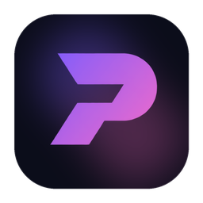

# PORTZEN Studio

**TR** — Videonu Claude tasarlasın, sen düzenle. Yapay zekanın Reels, TikTok ve Shorts videolarını tasarladığı, senin de bir video editöründe düzenlediğin ücretsiz masaüstü uygulaması.

**EN** — Let Claude design your video. You edit it. A free desktop app where AI designs your Reels, TikTok and Shorts videos and you fine-tune them in a real video editor.

## İndir / Download

| | |
|---|---|
| **Windows 10/11 (64-bit)** | [PORTZEN-Studio-Windows-Setup.exe](https://github.com/ardakaya7440-svg/portzen-studio/releases/latest/download/PORTZEN-Studio-Windows-Setup.exe) |
| **Mac — Apple Silicon (M1–M4), macOS 12+** | [PORTZEN-Studio-Mac.dmg](https://github.com/ardakaya7440-svg/portzen-studio/releases/latest/download/PORTZEN-Studio-Mac.dmg) |

Tüm sürümler / All versions: [Releases](https://github.com/ardakaya7440-svg/portzen-studio/releases)

## Gerekenler / Requirements

- Claude Pro/Max hesabı veya Anthropic API anahtarı / A Claude Pro/Max account or an Anthropic API key
- İnternet bağlantısı (Claude için) / An internet connection (for Claude)

## İlk açılış / First launch

- **Windows:** "Windows bilgisayarınızı korudu" → **Ek bilgi → Yine de çalıştır** / "Windows protected your PC" → **More info → Run anyway**
- **Mac:** **Sistem Ayarları → Gizlilik ve Güvenlik → Yine de Aç** / **System Settings → Privacy & Security → Open Anyway**

---

© 2026 PORTZEN. Claude, Anthropic'in markasıdır; PORTZEN Studio Anthropic ile bağlantılı değildir. / Claude is a trademark of Anthropic; PORTZEN Studio is not affiliated with Anthropic.
